# rl78dec — Native C++17 Renesas RL78 / 78K0R Decompiler & Scripting SDK for IDA Pro 9.5

`rl78dec` is a compiled native C++17 decompiler plugin (`rl78dec.dll`), standalone headless decompiler engine (`rl78dec_core.lib` / `rl78dec_cli.exe`), and multi-language scripting SDK (`IDAPython`, `ida_hexrays` shim, C ABI, and `IDC`) for **Renesas RL78 / 78K0R** microcontrollers (including PlayStation 4 and PlayStation Vita **syscon** firmware), built for IDA Pro 9.5+.

It pairs a zero-IDA-dependency C++17 decompiler core (`rl78dec_core.lib`) with an interactive Hex-Rays-parity pseudocode viewer (`Rl78Vdui`), incremental summary caching (`SummaryCache`), `$ rl78dec` netnode persistence, IDA Teams merge handlers (`merge.cpp`), and an RL78-gated (`PH.id == 0x8078` / `"rl78"`) `ida_hexrays` compatibility bridge (`rl78dec_hexrays_bridge.py`).

```mermaid
flowchart LR
    Decoder["1. Decoder (decoder.cpp)"] --> Lifter["2. IR Lifter (lifter.cpp)"]
    Lifter --> CFG["3. CFG Builder (cfg.cpp)"]
    CFG --> Frame["4. Frame Analysis (frame.cpp)"]
    Frame --> Spill["5. Spill Elimination (spill.cpp)"]
    Spill --> Opt["6. Canonical Opt (opt.cpp)"]
    Opt --> ABI["7. ABI & Far Ptr (abi.cpp)"]
    ABI --> Vars["8. Def-Use Webs (vars.cpp)"]
    Vars --> Struct["9. Structurer (structure.cpp)"]
    Struct --> CTree["10. ctree & C Emitter (ctree.cpp / cgen.cpp)"]
    CTree --> ViewSDK["Native Viewer (view.cpp) & Python / C / IDC SDK"]
```



---

## Key Capabilities & Architectural Support

### 1. RL78 / 78K0R ISA Coverage & Native C Lowering
- **RL78-S1 / S2 / S3 Instruction Lifting**: Decodes and lifts 8-bit/16-bit register pairs (`A/X/AX`, `B/C/BC`, `D/E/DE`, `H/L/HL`), `RB0`–`RB3` bank selection (`SEL RBn`), hardware multiply/divide/MAC instructions (`MULU`, `MULH`, `MULHU`, `DIVHU`, `DIVWU`, `MACH`, `MACHU`), `CALLT` / `BRK`, `BTCLR`, `MOVS` / `CMPS`, variable-length `SK*` skips, and `BR AX` jump tables into structured `switch` statements.
- **20-Bit Far Pointers, `ES:` Resolution & Native Memory References**: Tracks `ES` segment assignments and propagates 20-bit linear addresses across register/stack far pointer pairs, resolving references directly to native IDA symbols (`byte_FB3E5`, `word_FB2CE`, typed structs, and array accesses) rather than raw memory intrinsics.
- **`saddr` & SFR Awareness**: Handles `saddr` wraparound addressing and Renesas RL78 Special Function Register (SFR) names.
- **Multi-Register (`DE:BC`) 32-Bit Returns**: Recovers `uint32_t` return values across `DE:BC` and lowers subregister slices cleanly.
- **Caller-Consensus ABI & Virtual Variable Recovery**: Resolves register/stack parameters, eliminates spill/reload pairs (`PUSH`/`POP`) and machine `XCH` placeholders, and recovers disjoint virtual variables (`v0`, `v1`, ...).

### 2. Interactive Viewer & Hex-Rays Parity (`rl78dec - Pseudocode`)
- **Strict Architecture Isolation (`PLUGIN_PROC | PLUGIN_MULTI`)**: Loads and hooks events strictly when `PH.id == 0x8078` or `PH.psnames[0]` starts with `"rl78"` (returning `nullptr` immediately on all non-RL78 databases so other decompilers and Hex-Rays are never affected).
- **Exact Instruction EA Anchoring (`COLOR_ADDR`)**: Every C statement maps cleanly to its originating instruction EA for disassembly synchronization.
- **Bidirectional Cursor Sync & History Navigation**: Live sync between `IDA View-A` and `rl78dec - Pseudocode`, clickable symbols/callees, and backward/forward navigation history (`Esc` / `Ctrl-Return`).
- **`$ rl78dec` Netnode Persistence & IDA Teams Support**: Persists renames, variable types, prototypes, comments, number formats, inverted branches, cast visibility, and desktop dock layout in `$ rl78dec`, with 3-way merge handlers (`merge.cpp`).

| Shortcut | Action | Description |
| :--- | :--- | :--- |
| **`F5`** | Decompile RL78 function | Open / focus pseudocode view (or refresh active view) |
| **`Ctrl-F5`** | Decompile all RL78 functions | Decompile all functions in the database |
| **`Ctrl-Shift-S`** | Clear `rl78dec` caches | Clear cached summaries and pseudocode objects |
| **`N`** | Rename variable / symbol | Rename local, parameter, global, or function |
| **`Y`** | Set C type / prototype | Set variable type or C function prototype |
| **`/`** or **`;`** | Edit comment | Add or edit statement comment |
| **`H`** | Hexadecimal / Decimal | Toggle hexadecimal ↔ decimal constant format |
| **`R`** | Character constant | Toggle character literal format |
| **`B`** | Binary literal | Toggle binary (`0b...`) literal format |
| **`Shift--`** (`_`) | Signed / Unsigned decimal | Toggle signed ↔ unsigned decimal format |
| **`I`** | Invert `if`/`else` branches | Invert condition and swap branches |
| **`\`** | Hide / Show scalar casts | Toggle scalar cast display |
| **`X`** | Jump to xrefs | Show cross-references for symbol under cursor |
| **`G`** | Jump to address | Navigate to address or function |
| **`Tab`** | Switch to disassembly | Jump to matching instruction in `IDA View-A` |
| **`Esc`** / **`Ctrl-Return`** | Navigate back / forward | Step through pseudocode navigation history |
| **`Alt-S`** | Sync cursor | Toggle live disassembly cursor synchronization |
| **`Shift-I`** | Toggle C / IR view | Switch between C pseudocode and lifted SSA IR |

---

## Multi-Language Decompiler Scripting SDK

### 1. Zero-Change `ida_hexrays` Shim (`python_sdk/rl78dec_hexrays_bridge.py`)
When an RL78 database is active, `rl78dec_hexrays_bridge.py` exposes a strictly RL78-gated proxy on `ida_hexrays` (delegating transparently to native `ida_hexrays` on all non-RL78 databases):

```python
import ida_hexrays

assert ida_hexrays.init_hexrays_plugin()
cf = ida_hexrays.decompile(0x35FB)
print(cf)

class CallCollector(ida_hexrays.ctree_visitor_t):
    def __init__(self):
        super().__init__(ida_hexrays.CV_PARENTS)
        self.calls = []

    def visit_expr(self, e):
        if e.op == ida_hexrays.cot_call:
            self.calls.append((e.ea, e.dstr()))
        return 0

v = CallCollector()
v.apply_to(cf.body, None)
```

Also supports live AST mutation (`swap_branches`, `cnumber_t._value`, `cf.refresh_func_ctext()`), `vdui_t`, and `Hexrays_Hooks`.

### 2. Python `rl78dec` FFI Package (`python_sdk/rl78dec/`)
```python
import rl78dec

print(rl78dec.decompile(0x35FB))       # Plain C string
print(rl78dec.dump(0x35FB))            # Lifted & optimized IR dump
cf = rl78dec.cfunc(0x35FB)             # cfunc_t with ctree AST
rl78dec.decompile_all("syscon.c")      # Batch decompile all functions

rl78dec.db.set_var_rename(0x35FB, "a0", "queue")
rl78dec.db.set_statement_cmt(0x35FB, 0x35FB, "Entry point")
```

### 3. Native C ABI (`include/rl78dec/rl78dec_c_api.h`)
`rl78dec.dll` exports `rl78dec_abi_*` C symbols for external native consumers, including `rl78dec_abi_decompile`, `rl78dec_abi_decompile_text`, `rl78dec_abi_dump_ir`, `rl78dec_abi_decompile_all`, `rl78dec_abi_cfunc_json`, `rl78dec_abi_cfunc_mutate_item`, `rl78dec_abi_open_pseudocode`, and `$ rl78dec` annotation mutators.

### 4. Built-in IDC Functions (`src/ida/idc_funcs.cpp`)
`rl78dec.dll` registers 9 native IDC functions on RL78 databases:
`rl78dec_version()`, `rl78dec_decompile(ea)`, `rl78dec_dump_ir(ea)`, `rl78dec_decompile_all(out_path)`, `rl78dec_open_pseudocode(ea, flags)`, `rl78dec_rename_lvar(func_ea, old_name, new_name)`, `rl78dec_set_lvar_type(func_ea, var_name, type_str)`, `rl78dec_set_proto(func_ea, proto_str)`, and `rl78dec_clear_caches()`.

---

## Standalone Headless CLI (`rl78dec_cli.exe`)

Accepts raw RL78 flash dumps or Sony FUPD containers without requiring IDA:

```powershell
# Decompile entire firmware via vector table entries
.\build\rl78dec_cli.exe syscon.bin -o syscon.c

# Decompile specific entry point(s)
.\build\rl78dec_cli.exe syscon.bin --ea 0x35FB

# Dump lifted & optimized IR
.\build\rl78dec_cli.exe syscon.bin --ea 0x35FB --ir
```

---

## Building, Testing & Deploying

### Prerequisites
- Visual Studio 2022 / 2026 x64 C++17 toolchain (`cl.exe`), CMake 3.20+, and Ninja
- IDA Pro 9.5 SDK (`IDA_SDK_DIR` auto-detected when inside `ida-sdk/src/plugins/rl78dec`)
- fail0verflow's [RL78 processor module](https://github.com/fail0verflow/rl78-ida-proc) installed in IDA Pro

### Build & Run C++ Unit / Differential Tests
```powershell
cmake -S . -B build -G Ninja -DCMAKE_BUILD_TYPE=Release
cmake --build build --parallel
.\build\rl78dec_tests.exe
```

### Deploy to User IDA Plugins Directory (`%APPDATA%\Hex-Rays\IDA Pro\plugins`)
```powershell
cmake --build build --target rl78dec_deploy
```
This installs `rl78dec.dll`, `rl78dec_hexrays_bridge.py`, and the `rl78dec/` Python FFI package from `python_sdk/` into `%APPDATA%\Hex-Rays\IDA Pro\plugins\` (and removes any legacy `rl78dec_plugin.py`).

### Headless IDA Pro 9.5 Tier 5 Corpus Verification
Run `ctests/ida_verify_and_bench.py` against local RL78 databases (automatically copied to `%TEMP%` before opening):
```powershell
python ctests/ida_verify_and_bench.py --workspace . --idat "C:\Program Files\IDA Professional 9.5\idat.exe"
```
Validates zero-import `ida_hexrays`, `ctree_visitor_t` (`cit_switch`, live AST mutation), `Hexrays_Hooks`, `$ rl78dec` netnode persistence, `COLOR_ADDR` anchors, zero IR problems (`verify_ir=true`), zero unhandled markers, and full-corpus MSVC `cl.exe /Zs /W3 /TC` compilation across `DOL-1001-VTE-1001-00703030.i64` and `syscon-1.01.bin.i64`.

---

## Legacy Python Version (Deprecated)

The original pure-Python prototype (`rl78dec/`, `rl78dec_plugin.py`, and `tests/`) is **deprecated and unmaintained**, and has been archived under [`legacy_py/`](legacy_py/README.md) for historical reference only. New installations should build and deploy the native C++17 plugin (`rl78dec_deploy`) and use `rl78dec_cli.exe` / `python_sdk/`.

---

## Credits & License

- Built on the RL78 reverse-engineering work of **fail0verflow** (RL78 processor module, syscon loader) and **astrelsky/hedgeberg** (Ghidra SLEIGH).
- Decompiler architecture inspired by zecoxao's **`spudec`**.
- MIT License. No proprietary firmware is included.
